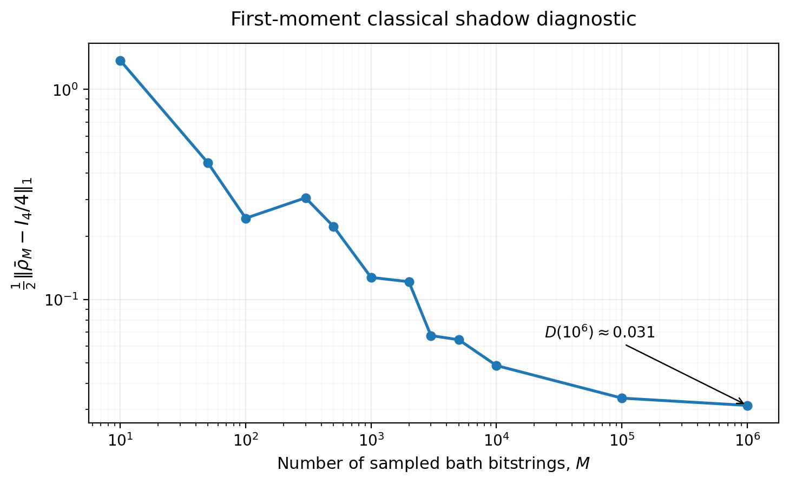

# ThermalGPT: Generative Modeling of Quantum Measurement Data

**A PyTorch Transformer for learning conditional measurement statistics of quantum many-body states, generating new measurement samples, and evaluating them with classical shadows.**

ThermalGPT is an exploratory project at the intersection of **quantum information**, **generative machine learning**, and **scientific computing**. Inspired by [ShadowGPT](https://arxiv.org/abs/2411.03285), it studies whether a generative model trained on simulated measurements can reproduce the statistics of *measurement-conditioned subsystem states*.

The repository provides a compact end-to-end workflow: **conditional Transformer training → measurement generation → statistical benchmarking → classical shadow reconstruction**.

## Physical setting and motivation

Consider a pure quantum many-body state $|\Psi\rangle$ divided into a subsystem $A$ and a bath $B$. Measuring $B$ in the computational ($Z$) basis gives a bitstring $z_B$ and prepares a conditional state on $A$,

$$
|\psi_A(z_B)\rangle =
\frac{(I_A\otimes \langle z_B|)|\Psi\rangle}{\sqrt{p(z_B)}},
\qquad
p(z_B)=\left\|(I_A\otimes\langle z_B|)|\Psi\rangle\right\|^2.
$$

The collection of conditional states, weighted by their measurement probabilities, is called a **projected ensemble**. Such ensembles arise naturally in studies of quantum thermalization and measurement-induced statistics.

Instead of representing every $|\psi_A(z_B)\rangle$ explicitly, ThermalGPT learns the probability of measurement outcomes on $A$ from the bath outcome and the chosen local Pauli measurement bases:

$$
p_\theta(\mathbf b\mid z_B,\mathbf P),
\qquad P_i\in\{X,Y,Z\},\quad b_i\in\{0,1\}.
$$

The implementation uses **16 qubits in total**, with **2 subsystem qubits** and **14 bath qubits**. The input measurement records are generated from numerical quantum-state data.

## Model and training objective

The conditional generative model is implemented from scratch in **PyTorch** using:

- Learnable embeddings of bath bits, Pauli measurement choices, and positions.
- A feed-forward network that compresses the bath bitstring into a context token.
- **4 Transformer blocks**, each with multi-head self-attention (**4 heads**) and feed-forward layers; embedding dimension **128**.
- Autoregressive prediction of subsystem outcomes, with **CUDA** support for training and inference.

For the two-qubit subsystem, the learned distribution factorizes as

$$
\begin{aligned}
p_\theta(b_1,b_2\mid z_B,P_1,P_2)
&=p_\theta(b_1\mid z_B,P_1)\\
&\quad\times p_\theta(b_2\mid z_B,P_1,b_1,P_2).
\end{aligned}
$$

The model receives only the available prefix at each prediction step. It is trained by minimizing the **average negative log-likelihood** (implemented with `torch.nn.CrossEntropyLoss`):

$$
\mathcal L(\theta)=
-\mathbb E_{(z_B,\mathbf P,\mathbf b)\sim\mathcal D}
\left[\frac{1}{L_A}\sum_{i=1}^{L_A}
\log p_\theta(b_i\mid z_B,P_{1:i},b_{1:i-1})\right].
$$

Training uses **AdamW**, a training/validation split, and validation-loss-based early stopping. Separate checkpoints are trained for different bath bit-count sectors $Q_B=\sum_i z_{B,i}$.

## Generated data and benchmarking

At inference time, the model is conditioned on a bath bitstring $z_B$. For each subsystem qubit, a measurement basis $P_i\in\{X,Y,Z\}$ is sampled uniformly and an outcome $b_i$ is generated from the learned conditional distribution.

In `Data_generation_seen_z.ipynb`, a fixed bath outcome is used to generate **180,000 measurement records**. The empirical probabilities for all **9 two-qubit Pauli-basis combinations** are compared with Born-rule probabilities calculated from the reference wavefunction. The notebook reports:

- **Total variation distance (TVD)** between generated and reference distributions.
- **Mean squared error (MSE)** of outcome probabilities.
- **Kullback–Leibler divergence (KL)** for each measurement basis.

These comparisons test the learned measurement distribution directly, before using it for quantum-state estimation.

## Classical shadows and trace-norm diagnostic

Each generated pair of Pauli bases and measurement outcomes produces a **single-shot classical shadow estimator**,

```math
\hat\rho_A^{(j)}
=\bigotimes_{i=1}^{L_A}
\frac{I+3(-1)^{b_i^{(j)}}P_i^{(j)}}{2}.
```

The estimators are averaged over the generated records,

```math
\bar\rho_M=\frac{1}{M}\sum_{j=1}^{M}\hat\rho_A^{(j)}.
```

The final notebook evaluates the **trace-norm discrepancy** from the maximally mixed two-qubit state, which is the **first moment of the Haar ensemble**:

```math
D(M)=\frac{1}{2}\left\|\bar\rho_M-\frac{I_4}{4}\right\|_1,
\qquad \|X\|_1=\mathrm{Tr}\sqrt{X^\dagger X}.
```

### Numerical result



*Figure: Trace-norm discrepancy $D(M)$ versus the number $M$ of sampled bath bitstrings (logarithmic axes), reproduced from the values saved in `Classical_Shadows.ipynb`. The discrepancy generally decreases with sample count, reaching approximately **0.031** at $M=10^6$ in this run.*

This result probes **first-moment reconstruction**, not the distance between full quantum-state ensembles. In particular, agreement with $I_4/4$ does **not** establish agreement with higher Haar moments or the complete projected-ensemble distribution. Moreover, finite-sample classical shadow averages need not be positive semidefinite, so $D(M)$ is best interpreted as a **trace-norm diagnostic** rather than necessarily the trace distance between two physical density matrices.

**Scope of the experiment.** The final notebook samples bath bitstrings uniformly rather than from their physical Born distribution, and skips charge sectors without a trained model while still normalizing by the original number of draws. As a result, the plot should be viewed as an exploratory diagnostic, not a precision benchmark of the physical projected ensemble or a demonstration of convergence to an exact Haar ensemble.

## Repository contents

| File | Purpose |
| --- | --- |
| [`ThermalGPT.py`](ThermalGPT.py) | PyTorch model definition, training and validation loops, checkpointing, and conditional sampling. |
| [`Data_generation_seen_z.ipynb`](Data_generation_seen_z.ipynb) | Generate measurements for a specified bath outcome; compare empirical distributions with reference Born probabilities. |
| [`Classical_Shadows.ipynb`](Classical_Shadows.ipynb) | Convert generated measurement records into classical shadow estimators and evaluate the first-moment trace-norm diagnostic. |

## Tools and skills demonstrated

**Machine learning:** PyTorch, Transformer architectures, attention and embeddings, autoregressive generation, cross-entropy optimization, model validation, and GPU/CUDA workflows.

**Scientific computing:** Python, NumPy, pandas, SciPy, Matplotlib, Jupyter/Google Colab, probability-distribution benchmarking, and numerical linear algebra.

**Quantum information:** Measurement-conditioned states, projected ensembles, Born-rule sampling, randomized Pauli measurements, and classical shadow tomography.

### Reproducibility notes

This repository currently contains the training and analysis code, but **not** the underlying simulation datasets, thermalized-state files, or trained model checkpoints referenced by the scripts. Some notebook paths point to a local Google Drive environment and must be adapted before running. The saved notebook outputs document the exploratory results shown here.

## Reference

J. Yao and Y.-Z. You, *ShadowGPT: Learning to Solve Quantum Many-Body Problems from Randomized Measurements*, [arXiv:2411.03285](https://arxiv.org/abs/2411.03285) (2024).

---

**Project by Rui-An Chang** · Quantum information, generative modeling, and computational physics.
